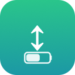

<p align="center">
  
</p>

<h1 align="center">NaturalOnBattery</h1>

<p align="center"><strong>Natural scrolling on battery, classic scrolling on power — automatically.</strong></p>

<p align="center">
  <a href="https://github.com/jackharvest/NaturalOnBattery/releases/latest"></a>
  
  <a href="LICENSE"></a>
</p>

NaturalOnBattery is a free, open-source macOS menu bar app that switches **natural scrolling** on when your Mac is running on battery and off when it's plugged into power — no manual trips to System Settings.

## The problem

macOS ties natural scrolling to a single global switch in **System Settings > Trackpad**, with no way to make it context-dependent. That's fine if you always use the same input device, but it's a hassle if you switch behavior depending on where you are — for example, natural (content-tracks-your-finger) scrolling on the built-in trackpad while working on the go, and classic (wheel-direction) scrolling once you're back at a desk on AC power with an external mouse. NaturalOnBattery automates that switch based on power source, so you don't have to remember to flip it yourself.

## Requirements

- macOS 13 (Ventura) or later

## Installing

### Option 1: Download the DMG (easiest)

1. Grab the latest `NaturalOnBattery-x.y.z.dmg` from [Releases](https://github.com/jackharvest/NaturalOnBattery/releases/latest).
2. Open it and drag **NaturalOnBattery** onto the **Applications** shortcut.
3. Open NaturalOnBattery from your Applications folder.

NaturalOnBattery isn't notarized by Apple (no paid developer account behind this), so on first open, macOS Gatekeeper will refuse to launch it as "from an unidentified developer." Right-click (or Control-click) **NaturalOnBattery.app** in Applications and choose **Open**, then confirm — you only need to do this once.

No other permission dialogs are involved: NaturalOnBattery only reads the current power source and writes the same scrolling preference System Settings itself writes, so it doesn't need Accessibility or any other privacy-gated access.

### Option 2: Build from source

No Xcode required — just the Swift toolchain that ships with Command Line Tools:

```sh
git clone https://github.com/jackharvest/NaturalOnBattery.git
cd NaturalOnBattery
./build.sh
cp -R NaturalOnBattery.app /Applications/
open /Applications/NaturalOnBattery.app
```

## Usage

Click the arrow-and-battery icon in the menu bar:

- **Enabled** — turns automatic management on/off. The status line above it always shows the currently computed state, e.g. "Natural scrolling — on battery."
- **Mode** — `Automatic (Natural on Battery)` (default), or force it with `Always Natural` / `Always Classic`.
- **Launch at Login** — starts NaturalOnBattery automatically next time you log in.
- **Uninstall NaturalOnBattery…** — removes the login item, clears saved settings, and moves NaturalOnBattery.app to the Trash (recoverable until you empty it). Your current scrolling setting is left as-is.
- **Quit NaturalOnBattery** — exits without uninstalling; whatever scrolling direction was last set stays that way.

## Uninstalling

Use the **Uninstall NaturalOnBattery…** menu item above — it handles everything in one confirmation click. If it won't launch for some reason, you can undo everything by hand instead:

1. Open **System Settings > General > Login Items**, remove NaturalOnBattery if it's listed.
2. Delete `/Applications/NaturalOnBattery.app`.
3. Optionally delete its saved settings: `defaults delete com.jackharvest.naturalonbattery`

## How it works

NaturalOnBattery watches for power source changes via `IOPSNotificationCreateRunLoopSource` — a push notification, not a polling timer — so it reacts the instant you plug or unplug. On each change (and on launch) it writes `com.apple.swipescrolldirection` in the global preferences domain via `CFPreferencesSetValue`, the exact same key System Settings > Trackpad > "Natural scrolling" controls, so the change takes effect system-wide immediately with no relaunch or logout needed.

## Releasing

`./release.sh` builds the app and packages it into a DMG (`NaturalOnBattery-x.y.z.dmg`) with the custom background in `scripts/dmg_background.png` and a drag-to-Applications layout, via [dmgbuild](https://github.com/dmgbuild/dmgbuild) (`pip3 install --user dmgbuild`). Bump `CFBundleShortVersionString` in `Info.plist` first.

## FAQ

**Does NaturalOnBattery need Accessibility permission?**
No. It only reads the current power source and writes a standard preference key — no input monitoring, no accessibility access.

**Is NaturalOnBattery safe to run? Does it send any data anywhere?**
NaturalOnBattery has no network code at all — it only reads the power source locally and writes a preference locally. Read `main.swift`; the entire app is a few hundred lines.

**Will this conflict with manually changing "Natural scrolling" in System Settings?**
No, but whatever you set by hand will be overwritten the next time your power source changes (or immediately, if you're not in Automatic mode) — use the menu's **Mode** submenu or the **Enabled** toggle instead if you want a setting that sticks.

**Why not just use BetterTouchTool or a similar general-purpose utility?**
Those can do this too, and much more, but they're large general-purpose tools. NaturalOnBattery is a single-purpose, from-scratch, fully open-source implementation that does exactly one job.

## License

MIT, see [LICENSE](LICENSE).
